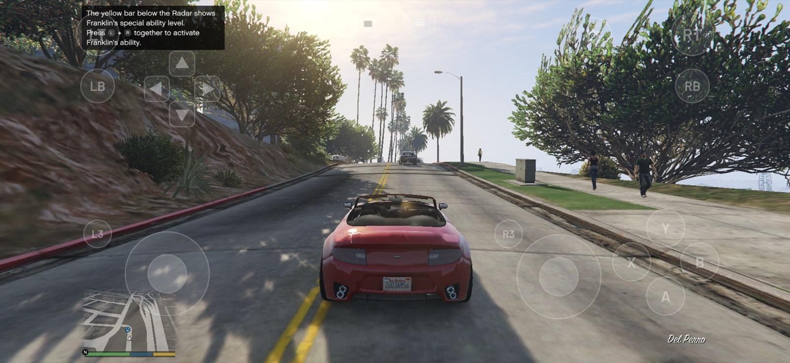
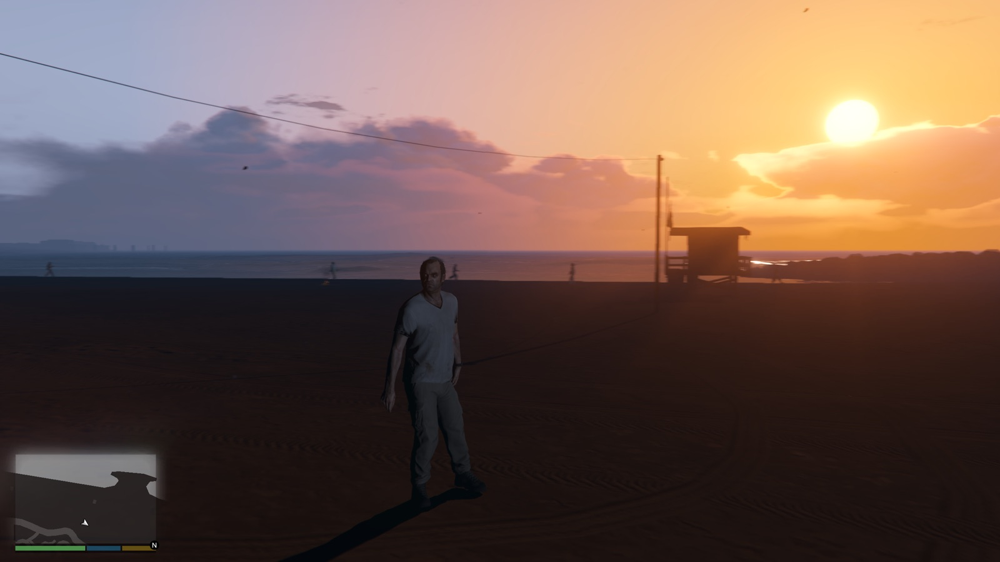
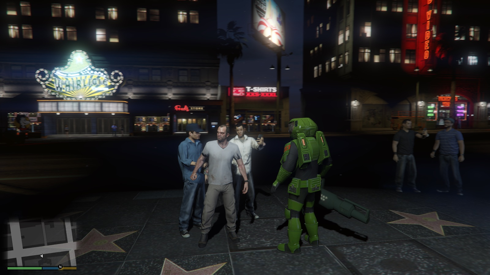
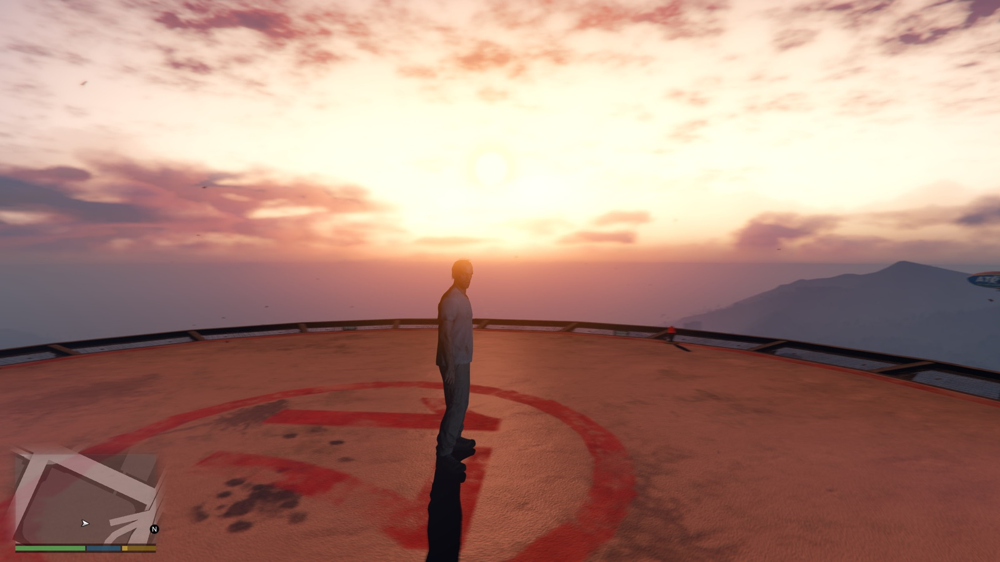
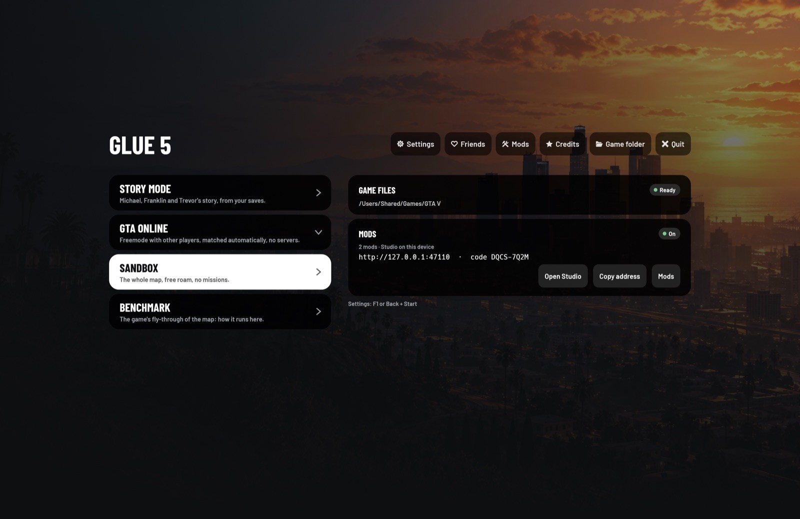
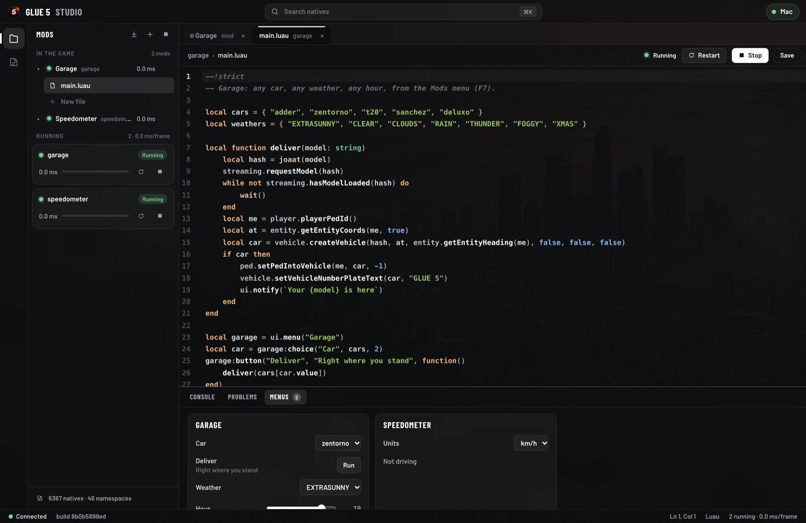

  

<h1 align="center">GLUE 5</h1>

  <b>GTA V, running natively on your iPhone, iPad, Mac, Android phone and PC.</b> 
  A recompiler and runtime for the game's WebAssembly build: no emulator, no JIT, nothing rendered in the cloud.

  
  
  
  

<!-- Hero image: GLUE 5 on a MacBook Pro, an iPad, an iPhone and an Android phone (docs/images/hero.jpg, to come). -->

> [!IMPORTANT]
> GLUE 5 contains **no game files**. It turns files you supply, from GTA V's
> **WebAssembly build** (`game.wasm`, its translated shaders and its prepared
> data), into an app for your device. Files from a regular PC or console
> installation are not enough. GLUE 5 is not affiliated with Rockstar Games
> or Take-Two Interactive.

## Highlights

- **Native on every device.** The game's code is compiled ahead of time
  for your device's CPU and drawn with Metal on Apple devices, Vulkan
  elsewhere. MetalFX and FSR 2 upscaling, frame generation on Apple
  silicon, frame pacing matched to the display.
- **Made for touch and controllers.** An on-screen controller that hides
  as soon as you pick up a gamepad or a keyboard, haptics, aim assist and
  the game's own button prompts for whatever you hold.
- **GTA Online, without servers.** Freemode sessions between GLUE 5
  players, found automatically on your network and over the Internet.
  Friends, invites and joins, end-to-end encrypted.
- **Your files, on every screen.** Keep the game on one computer and
  stream it to your phone, tablet or Apple TV, or copy it once and play
  offline.
- **Mods in Luau, with a Studio.** Write mods in your browser, with every
  one of the game's 6,000+ native functions typed and documented. Menus
  that work with touch and controllers. Coding agents can drive it too.

## Screenshots

<table>
  <tr>
    <td width="50%"></td>
    <td width="50%"></td>
  </tr>
  <tr>
    <td></td>
    <td></td>
  </tr>
  <tr>
    <td></td>
    <td></td>
  </tr>
</table>

## Platforms

| Device | Status | Graphics | Notes |
|---|---|---|---|
| **iPhone, iPad** | ✅ Playable | Metal · MetalFX | iOS 16.4 or later. Tested on iPhone 16 Pro and iPhone 13 Pro. |
| **Mac** | ✅ Playable | Metal · MetalFX | macOS 14 or later, Apple silicon. |
| **Android** | 🧪 Early | Vulkan | Tested on Pixel 8a. |
| **Windows** | 🧪 Early | Vulkan | Builds; little tested. |
| **Linux** | 🧪 Early | Vulkan | AppImage, X11 and Wayland; little tested. |
| **Apple TV** | 🧪 Preview | Metal | Streams the game's files from a computer. Run in the simulator so far. |

## Get started

1. **Have your game files.** GTA V's WebAssembly build: `game.wasm`, its
   `shaders` folder and its `data` folder.
2. **Build the app.** The game's code ends up inside the app, so nobody
   can hand you a ready-made one: you build your own. The easiest way
   needs only a GitHub account: [build it on GitHub](docs/github-build.md),
   free, from your own `game.wasm`, which stays private. With a computer
   set up for development, [build it yourself](docs/building.md).
3. **Install it and add the files.** [Getting started](docs/getting-started.md)
   shows how on each device.

## Documentation

| | |
|---|---|
| [Getting started](docs/getting-started.md) | Install the app and put the game's files on each device. |
| [Playing](docs/playing.md) | Game modes, controls, settings, performance and troubleshooting. |
| [GTA Online and friends](docs/online.md) | Sessions, friends and invites without servers, and how they stay private. |
| [Streaming the game's files](docs/streaming.md) | Play from a computer's copy on your phone, tablet or Apple TV. |
| [Mods and GLUE 5 Studio](docs/mods.md) | Write mods in Luau, in your browser or with a coding agent. |
| [Build on GitHub](docs/github-build.md) | The app from your `game.wasm`, with no development setup. |
| [Building from source](docs/building.md) | Toolchain, tasks, platforms, options and the repository's layout. |
| [Design notes](docs/design.md) | How it works inside: the recompiler, the renderer, streaming, mods. |

## FAQ

<b>Is the game included?</b>

No. GLUE 5 is the recompiler and the runtime around the game. You supply
the game's files, from its WebAssembly build.

<b>Why can't I just download the app?</b>

The app is made from the game's own code (`game.wasm`), compiled for your
device. An app built from it contains the game, so it is never shared:
everyone builds their own, from their own files. GitHub can do it for you
in your account ([how](docs/github-build.md)).

<b>Will it run on my phone?</b>

The game needs a recent device: on iPhone, a 13 Pro or newer plays well;
devices with less than 8 GB of memory use a low-memory profile (smaller
pools, lighter graphics) by default. In the game's benchmark an iPhone 16
Pro averages about 42 fps at the default settings. Phones get hot after a
while, and then slower: see [Performance](docs/playing.md#performance).

<b>Is GTA Online the real one?</b>

It is the game's own freemode, played between GLUE 5 players. Nothing
connects to Rockstar's services: sessions are hosted by the players, and
characters are kept on the device. See [GTA Online and friends](docs/online.md).

<b>Do I need a JIT, a jailbreak or developer mode?</b>

No. The game is compiled before it is installed, so it runs like any other
app. On iPhone and iPad you install it as your own app (sideloading, with
your Apple ID).

## Acknowledgements

GLUE 5 is built on [wasm2c](https://github.com/WebAssembly/wabt/tree/main/wasm2c),
[wgpu](https://wgpu.rs), [SDL](https://libsdl.org), [egui](https://github.com/emilk/egui),
[Luau](https://luau.org) with [mlua](https://github.com/mlua-rs/mlua),
[Leptos](https://leptos.dev), [CodeMirror](https://codemirror.net),
[snow](https://github.com/mcginty/snow), [mise](https://mise.jdx.dev) and
many other open-source projects: the app's Credits page lists them all,
with their licenses.

Grand Theft Auto and GTA are trademarks of Take-Two Interactive Software.
GLUE 5 is an independent project, not endorsed by or affiliated with
Rockstar Games or Take-Two Interactive.
