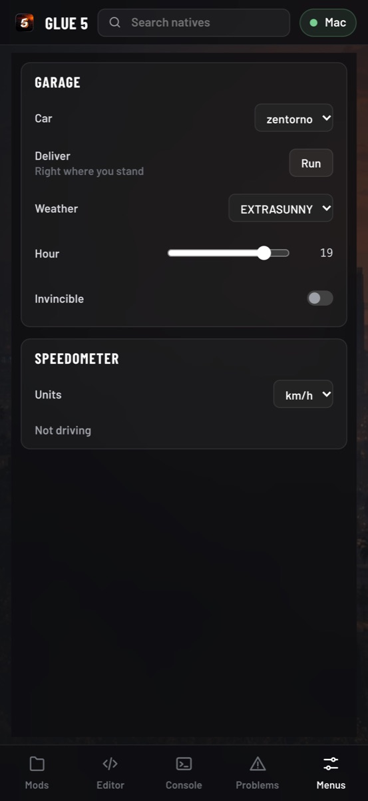

# Mods and GLUE 5 Studio

Mods are small [Luau](https://luau.org) scripts that run inside the game,
as the game's own scripts do, and call its native functions: spawn a car,
change the weather, add a menu. **GLUE 5 Studio** is the editor for them,
served by the app to your browser, on the same computer or from your phone
to your computer.

<p align="center">
  
</p>

## Using mods

1. Turn mods on: the **Mods** page (start page, Settings › Game › Mods, or
   F7 in the game), its **Mods** switch.
2. Put mods in the mods folder, one folder each, or import a `.zip` in the
   Studio. The folder is `mods` in the [user folder](getting-started.md#where-your-data-is)
   on computers, and next to the `game` folder on phones and tablets
   (`Documents/mods` on iPhone, where Files and the Finder reach it).
3. Start a game. Mods marked to start with the game run once you are in;
   the others start from the Mods page or the Studio.

Mods with a menu show it on the Mods page's **MENUS** (F7, or the button
next to ⚙ on touch screens), drawn by the app: it works with touch,
controllers, keyboard and mouse.

## GLUE 5 Studio

The Mods page's **Studio** tab starts it and shows its address, its
pairing code and a QR code. Open it in a browser on the same device, or
turn on **Other devices** and open the address on another one, a computer
or a tablet (phones default to it: their screens are no place to write
code).

<p align="center">
  
</p>

- **An editor that knows the game.** Every native is typed and documented,
  with completions, hovers and signatures as you type. Model names
  (vehicles, peds, weapons) come from your installed game, so a misspelt
  car is an error before it runs.
- **Live.** Saving restarts the mod in the running game. The console runs
  Luau in the game as you type it; each mod's log and errors come back
  with the line they came from.
- **Menus.** The mods' menus, mirrored from the game: use them from the
  Studio, your phone, or the game itself.
- **Mod pages.** Name, description, version, whether it starts with the
  game; export a mod as a `.zip`, import one.
- **Safe to connect.** Only a browser with the pairing code gets in, and
  only from the Studio's own page. A new code (Mods page) closes every
  connection made with the old one.

## Your first mod

A mod is a folder with a `main.luau`, and a `mod.json` that describes it.
This one adds a menu that delivers a car, and sets the weather and the
hour:

```lua
--!strict
-- Garage: any car, any weather, any hour, from the Mods menu (F7).

local cars = { "adder", "zentorno", "t20", "sanchez", "deluxo" }
local weathers = { "EXTRASUNNY", "CLEAR", "CLOUDS", "RAIN", "THUNDER", "FOGGY", "XMAS" }

local function deliver(model: string)
	local hash = joaat(model)
	streaming.requestModel(hash)
	while not streaming.hasModelLoaded(hash) do
		wait()
	end
	local me = player.playerPedId()
	local car = vehicle.createVehicle(hash, entity.getEntityCoords(me, true), entity.getEntityHeading(me), false, false, false)
	if car then
		ped.setPedIntoVehicle(me, car, -1)
		ui.notify(`Your {model} is here`)
	end
end

local garage = ui.menu("Garage")
local car = garage:choice("Car", cars, 2)
garage:button("Deliver", "Right where you stand", function()
	deliver(cars[car.value])
end)
garage:choice("Weather", weathers, 1, function(_, weather)
	misc.setWeatherTypeNowPersist(weather)
end)
garage:slider("Hour", 19, 0, 23, 1, function(hour)
	clock.setClockTime(hour, 0, 0)
end)
```

```json
{
  "name": "Garage",
  "description": "Any car, any weather, any hour: a menu for the open world.",
  "version": "1.0",
  "autostart": true
}
```

## What a mod can use

| | |
|---|---|
| **Natives** | The game's script functions by namespace, named the Luau way: `vehicle.createVehicle(...)`, `player.playerPedId()`; and by their game names, the same functions: `VEHICLE.CREATE_VEHICLE(...)`. Outputs come back as extra return values; a handle of 0 as `nil`, and `nil` (or 0) where a native takes none. A vector also goes as three numbers. |
| `native.invoke(hash, ...)` | A native by its ScriptHookV hash or its game name, as ScriptHookV calls it: `native.invoke("0xAF35D0D2583051B0", model, x, y, z, heading, false, false, false)`. See [Porting ScriptHookV mods](#porting-scripthookv-mods). |
| `globals` | The game scripts' globals by ScriptHookV's index: `globals.int(i)`, `float`, `bool`, `string`, `setInt(i, v)`..., `valid(i)`. |
| `memory` | The game's memory: `memory.entity(handle)` (an entity's address), `readFloat(address)`, `writeInt(address, v)`... (U8, U16, U32, Int, U64, Ptr, Float, Vector3, String), `read(address, bytes)` into a Luau `buffer` and `write(address, buffer)`, scratch memory for natives: `alloc(bytes)`, `free(address)`. |
| `game.version()` | The game build the natives, globals and offsets are for (`"8b0b5899ed"`). |
| `wait(ms)` | Back to the game for `ms` milliseconds (none: until the next frame). |
| `ui.menu(title)` | A menu: `toggle`, `slider`, `choice`, `button`, `label`. `ui.notify(text)` shows a notification. |
| `task.spawn`, `task.delay` | Coroutines on the game's clock (they stop while the game is paused). |
| `input` | The keyboard, the mouse and the player's pad as the game gets them: `input.isDown("F5")`, `input.pressed("PadSouth")` (since the mod's last turn), `input.onKey(function(key, down, mods) ... end)`, `input.mousePosition()`. Keys are named as on a US keyboard by position: `"A"`, `"F5"`, `"LeftShift"`, `"MouseLeft"`. |
| `world` | The vehicles, peds, objects and pickups around and the projectiles in flight, as handles: `world.vehicles()`, or only some, the closest first: `world.peds({ near = pos, radius = 50, model = "a_c_cat_01", max = 5 })`. And the installed game's model names. |
| `draw` | Images from the mod's folder over the game: `local logo = draw.loadImage("images/logo.png")` (PNG, waits while it is decoded), then each frame `draw.image(logo, 0.9, 0.1, 0.1, nil, { rotation = 15, color = { 255, 255, 255, 200 }, z = 1 })`; `draw.rect` and `draw.text` too, above the images or below. Centred positions and sizes in fractions of the screen, as DRAW_SPRITE's; drawn at the window's resolution over everything the game draws. A mod holds 64 images, 32 MB of them, at most (2048×2048 each), freed when it stops or by `image:release()`. |
| `json`, `storage` | JSON text, and values kept between sessions (1 MB a mod, for this player). |
| `db` | The mod's SQLite database: `db.exec("CREATE TABLE spots (name TEXT, x REAL)")`, `db.exec("INSERT INTO spots VALUES (?, ?)", name, x)`, `db.query("SELECT * FROM spots WHERE x > :x", { x = 10 })` (its rows as tables), `db.transaction(function() ... end)` (undone if it fails). One file for this player, as the storage, 256 MB at most. Queries run on the mod's turn: large work goes in a transaction (300 inserts in one take under a millisecond). |
| `net.request(url)` | HTTP and HTTPS, as [Lune](https://lune-org.github.io/docs)'s `@lune/net`: `net.request("https://...")` or `net.request({ url = ..., method = "POST", headers = {...}, body = ..., query = {...} })` gives `{ ok, statusCode, statusMessage, headers, body }`. It waits, as `wait()` does, while the request goes on away from the game. No answer (no network, a bad address, 30 s) is an error. 4 requests at once a mod, answers of 16 MB. |

Mods reach the network through `net` and keep data in `storage` and `db`;
other files are out of their reach.

Keys reach a mod when they reach the game: not while a page of the app is
open (the settings, the Mods page and its menus), not while the game's
text box takes typed text, and F1, F7 and Home are the app's. The game
sees them too: a mod that takes over one of the game's controls disables
it each frame, as the game's scripts do
(`pad.disableControlAction(0, control, true)`). On touch screens the touch
controls are the player's pad, so a mod for every device puts its
actions in a menu.

**A mod cannot take the game down** through the natives' namespaces. An
error stops that mod with its message and traceback; arguments are checked
before a native runs; a mod gets at most 2 ms a frame, and one that runs 2
seconds without waiting is stopped. `native.invoke`, `globals` and
`memory` are the exception: they do what ScriptHookV does, and can (see
below).

## Porting ScriptHookV mods

ScriptHookV's and ScriptHookVDotNet's calls have their counterparts:

| ScriptHookV | Here |
|---|---|
| `VEHICLE::CREATE_VEHICLE(...)`, `Function.Call(Hash.CREATE_VEHICLE, ...)` | `VEHICLE.CREATE_VEHICLE(...)` (typed, vectors as vectors and outputs as results), or `native.invoke("CREATE_VEHICLE", ...)` |
| `nativeInit(0xAF35D0D2583051B0); nativePush(...); nativeCall()` | `native.invoke("0xAF35D0D2583051B0", ...)` |
| `getGlobalPtr(i)` | `globals.int(i)`, `globals.setFloat(i, v)`... |
| `getScriptHandleBaseAddress(handle)` | `memory.entity(handle)` |
| `getGameVersion()` | `game.version()` |

- **Hashes** are the natives database's (nativedb), the ones ScriptHookV
  mods use; the game names too. Write a hash as a string,
  `"0xAF35D0D2583051B0"`: as a number it works, but past 2^53 Luau rounds
  it (the editor warns).
- **`native.invoke`** passes the arguments as ScriptHookV does: a
  `Vector3` as three numbers, a pointer as an address (`memory.alloc`) or a
  Luau `buffer` (copied in before the call and back after it, 16 KB at
  most); the native's result comes back. It also reaches the natives the
  namespaces leave out (structures and buffers: `COPY_SCRIPT_STRUCT`,
  `GET_EVENT_DATA`, the save natives), but not `WAIT` (use `wait()`).
- **Globals' indices depend on the game's scripts**: an index from a
  mod for another game version reads something else. Check each one
  against this game. Reads and writes are kept inside the blocks of
  globals the game has loaded.
- **Addresses** are the game's own (offsets in its memory); a pointer read
  from the game's objects (`memory.readPtr`) is an address too. Field
  offsets are not PC GTA V's (another build, another layout):
  ScriptHookVDotNet's offsets do not carry over, find them for this build.
- **What can crash the game.** Every address is checked against the
  game's memory, so nothing outside it is touched; inside it nothing is
  protected. A wrong write with `memory` or `globals`, a native given a
  buffer too small for what it writes, or a native that keeps a pointer
  (`START_SAVE_*`, `NETWORK_REGISTER_*_BROADCAST_VARIABLES`) given memory
  that is freed (by `memory.free`, or when the mod stops) can corrupt the
  game or make it stop. Installing such a mod is trusting its author.

## Coding agents

The Studio is also an [MCP](https://modelcontextprotocol.io) server: a
coding agent can write a mod and get its type errors, start it and read
its log, run Luau in the game, search the natives and use the mods' menus.
The Studio's welcome page shows the command for your game, for example:

```sh
claude mcp add --transport http glue5 http://<address>:47110/mcp --header "Authorization: Bearer <code>"
```

How mods run inside the engine is in the [design notes](design.md#mods).
